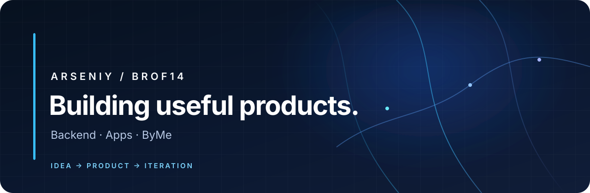

  

  <a href="https://parahin.space">Personal website</a>
  &nbsp;·&nbsp;
  <a href="https://github.com/Brof14?tab=repositories">Selected repositories</a>

## Hi, I'm Arseniy

I build software products and learn by shipping working projects. My current focus is the **ByMe** ecosystem: mobile and desktop VPN clients, backend services, and Telegram bots.

I work with **Python**, **Kotlin**, **TypeScript/JavaScript**, and **Rust**, and use tools including **PostgreSQL**, **Docker**, and **GitHub Actions**. I care about clear documentation, honest project status, and making systems safer and more reliable.

## Selected projects

| Project | Description |
| --- | --- |
| [ByMeVPN for Android](https://github.com/Brof14/ByMeVPN-app) | Android client in Kotlin and Jetpack Compose; active development |
| [ByMeVPN for Windows](https://github.com/Brof14/ByMeVPN-app-windows) | Tauri and Rust desktop client; VPN runtime integration is in progress |
| [ByMeAudio Bot](https://github.com/Brof14/ByMeAudio_bot) | Telegram bot for local audio transcription with Faster-Whisper |
| [ByMeSaved](https://github.com/Brof14/ByMeSaved) | Telegram knowledge manager with semantic search and Markdown export |
| [ByMeVideo](https://github.com/Brof14/ByMeVideo) | Telegram media workflow using yt-dlp, FFmpeg, Redis, and PostgreSQL |
| [ByMeVPN site](https://github.com/Brof14/ByMeVPN-site) | Static product website |

## Currently learning

CS50x · software architecture · backend engineering · product development

---

Building, documenting, and improving one iteration at a time.

